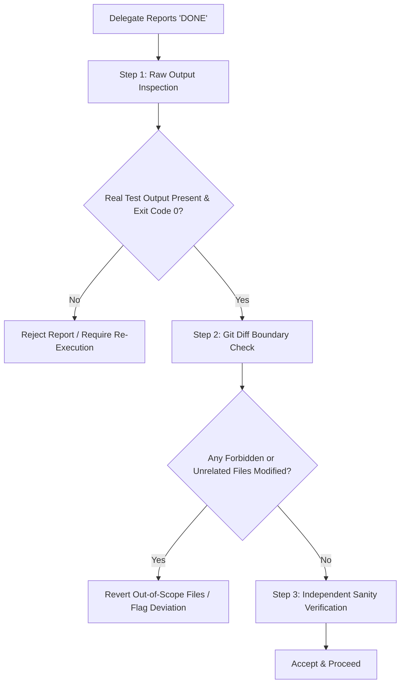

# Multi-Agent Delegation and Fidelity Contracts

This reference guide details the protocols, communication schemas, and verification receipt standards required when delegating tasks across multi-tier agent hierarchies (Master Agent → Superagent → Subagent), autonomous swarms, or external CLI bridges (Codex, Claude Code, AGY).

---

## 1. The Threat of Hierarchical Degradation

In multi-agent systems, instructions degrade rapidly across hierarchical boundaries if delegated casually:

```text
User Request
  │ (Full nuance, negative constraints, environmental context)
  ▼
Master Agent
  │ ──► [Lossy Summarization]
  ▼
Superagent
  │ ──► [Vague "Look into it" Brief]
  ▼
Subagent
  └──► [Hallucinated Scope, Violated Constraints, Unchecked Victory]
```

**The Law of Lossless Propagation**: A delegating agent is personally responsible for the fidelity of all work performed by its delegates. Delegating a task does not delegate accountability.

---

## 2. The Universal Delegation Brief Schema

Whenever invoking a child agent, background worker, or external CLI tool, the delegating agent MUST supply a structured **Delegation Brief** containing these 6 mandatory sections:

```markdown
### 1. Concrete Objective
- A bounded, actionable statement of the exact deliverable.
- Explicitly state whether this is an investigation, code modification, test creation, or review.

### 2. Strict Scope Boundaries
- **Allowed Target Paths**: Exact file paths or directories the delegate is authorized to create or edit.
- **Forbidden Paths**: Explicitly protected files, directories, or configs the delegate must NEVER touch.
- **Git Worktree / Directory**: The designated working copy or isolated path.

### 3. Constraint Invariants
- **Negative Constraints ($C^-$)**: What the delegate must NOT do (e.g. no new dependencies, no signature changes, no broad refactors).
- **Environment Invariants ($C^{env}$)**: Shell syntax (e.g. PowerShell `;` separator), package manager (`bun`), runtime version.

### 4. Acceptance Criteria & Test Commands
- Exact criteria defining completion.
- Exact terminal command the delegate must run to prove completion (e.g., `bun test tests/unit.test.ts`).

### 5. Non-Interference Directives
- Check for concurrent agent activity via `git status` before touching files.
- Never run blanket commands (`git add .`, `git checkout .`, `git restore .`).
- Touch only the explicitly assigned files.

### 6. Required Completion Receipt
- The delegate must return:
  1. Status (`DONE` | `PARTIAL` | `BLOCKED`).
  2. Exact list of modified files.
  3. Raw terminal command execution output demonstrating passing verification.
  4. Concise summary of key changes.
```

---

## 3. Delegation Example: Master Agent to Feature Superagent

### Bad Delegation Brief (High Drift Risk)
> *"Hey Superagent, please fix the token tracking bug in ContextManager and make sure tests pass."*
*(Fails to specify target files, negative constraints, verification commands, or non-interference rules).*

### Good Delegation Brief (Instruction-Fidelity Compliant)
> *"### Objective
> Fix the token tracking calculation in `TokenTracker.ts` where image tokens are undercounted during context compaction.
>
> ### Scope Boundaries
> - **Allowed Paths**: `src/core/context/TokenTracker.ts`, `tests/core/context/TokenTracker.test.ts`
> - **Forbidden Paths**: `src/core/context/ContextManager.ts`, `package.json`, and all other core files.
> - **Isolation**: Work in your assigned worktree `~/.superagent-r/worktrees/token-fix`.
>
> ### Constraints
> - Do not change the public method signature of `countTokens()`.
> - Do not add external tokenization libraries; use existing tiktoken bindings.
> - Environment: Windows PowerShell (use `;` instead of `&&` for command chaining).
>
> ### Acceptance & Verification
> - Add a test case for image token counting with multiple dimensions.
> - Verification Command: `bun test tests/core/context/TokenTracker.test.ts` (all tests must pass with exit code 0).
>
> ### Required Receipt
> Return status, changed files, git diff summary, and the raw test output before requesting merge."*

---

## 4. The Verification Receipt Protocol (Parent Inspection)

A parent coordinator must **NEVER** accept a delegate's self-reported success at face value. The parent must execute the **Three-Step Receipt Audit** before incorporating or merging the delegate's work:



### Step 1: Raw Output Inspection
- Inspect the actual command output provided by the delegate.
- Verify the test command executed matched the assigned suite.
- Verify that 0 tests failed and the exit code was 0.

### Step 2: Git Diff Boundary Check
- Run `git status` or inspect the delegate's diff.
- Verify that **NO files outside the assigned scope** were created, modified, or deleted.
- If the delegate touched unassigned files, reformatters, or unrelated modules, revert those unauthorized changes immediately before merging.

### Step 3: Independent Sanity Verification
- If merging work from a worktree into the main workspace, run the top-level build or test suite (`bun run build` or `bun test`) to confirm that merging the delegate's work does not break workspace integrity.

---

## 5. Protocol for Delinquent or Stalled Delegates

If a delegate exhibits any of the banned failure modes:
1. **Planning Stall**: The delegate outputs a plan instead of executing code.
   - *Parent Action*: Prompt the delegate immediately: *"Execute the implementation in your assigned files now. Do not provide further outlines; run the code edits and verify with tests."*
2. **Constraint Violation**: The delegate introduces an unauthorized package or edits forbidden files.
   - *Parent Action*: Revert the unauthorized edits, reiterate the negative constraint, and instruct the delegate to implement the solution within permitted boundaries.
3. **Repeated Failures**: If a delegate fails twice consecutively without diagnosing root cause, terminate or kill the delegate, inspect the problem directly or spawn a fresh specialist with an updated, more specific brief.
