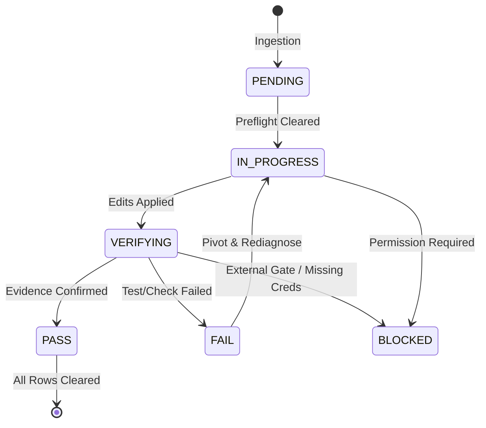

# Verification Protocols and Evidence Ledger Standard

This reference guide establishes the empirical verification protocol and the formal **Execution Ledger** standard required for all tasks under the Instruction Fidelity doctrine. Under this standard, claims of completion without observable terminal evidence are strictly invalid.

---

## 1. The Four-Tier Verification Hierarchy

To prove that a software task is faithfully completed, verification must progress through four concentric verification tiers:

```text
┌─────────────────────────────────────────────────────────────────────────────┐
│                       THE 4-TIER VERIFICATION HIERARCHY                     │
├─────────────────────────────────────────────────────────────────────────────┤
│  Tier 4: Diff & Non-Interference Audit (Zero collateral damage, clean diff) │
│    ▲                                                                        │
│  Tier 3: End-to-End & Integration (Live CLI execution, UI/DOM, system state)│
│    ▲                                                                        │
│  Tier 2: Automated Unit & Regression Tests (Passing test suites, zero breaks)│
│    ▲                                                                        │
│  Tier 1: Static Integrity (Type checking, linting, syntax validity)         │
└─────────────────────────────────────────────────────────────────────────────┘
```

---

### Tier 1: Static Integrity
- **Purpose**: Verify that no syntax errors, unresolved types, broken imports, or lint violations were introduced.
- **Verification Commands by Ecosystem**:
  - **TypeScript / JavaScript**:
    - `bun run build` or `bun x tsc --noEmit`
    - `npx tsc --noEmit`
  - **Python**:
    - `python -m py_compile <file>`
    - `mypy <target_directory>`
    - `ruff check <target_directory>`
  - **Go**: `go vet ./...`
  - **Rust**: `cargo check`

---

### Tier 2: Automated Unit & Regression Tests
- **Purpose**: Verify that the newly introduced logic behaves as expected and that existing passing tests continue to pass without regression.
- **Execution Rules**:
  - Run focused tests first (testing the exact modified unit).
  - Run the adjacent regression suite to ensure consumers remain intact.
  - **Never skip or comment out failing tests** to force a test run to pass.
- **Verification Commands by Ecosystem**:
  - **Bun / Vitest / Jest**:
    - `bun test <path/to/test.ts>`
    - `npx vitest run <path/to/test.ts>`
    - `npm test -- <path/to/test.ts>`
  - **Python**:
    - `pytest tests/test_<feature>.py -v`
    - `python -m unittest tests/test_<feature>.py`
  - **Rust**: `cargo test <test_name>`

---

### Tier 3: End-to-End & Live Runtime Verification
- **Purpose**: Exercise the real system end-to-end to confirm observable user-facing behavior.
- **Execution Rules**:
  - Execute the actual CLI command with sample arguments.
  - Inspect output files, database entries, or HTTP responses.
  - For UI / Frontend work, inspect the rendered component, DOM elements, or run Playwright/headless tests.
- **Examples**:
  - Running a CLI tool: `bun run src/cli.ts --help` or `bun run start --status`
  - Inspecting a generated JSON artifact: verify schema and contents via command line.
  - Testing an API endpoint: make a curl or fetch request and inspect the status code and response payload.

---

### Tier 4: Diff & Non-Interference Audit
- **Purpose**: Prove that changes are strictly isolated to authorized requirements and that no concurrent work was clobbered.
- **Protocol**:
  1. Run `git diff --stat` to inspect the list of modified files. Confirm every file in the list is strictly in-scope.
  2. Run `git diff <file>` on each changed file.
  3. Inspect every added (`+`) and removed (`-`) line:
     - Is this line strictly required to satisfy the user prompt?
     - Did I accidentally reformat whitespace or alter untouched code?
     - Did I leave temporary `console.log` statements, debugging probes, or commented-out code?
     - Did I accidentally stage or touch untracked files belonging to another agent?

---

## 2. The Formal Execution Ledger Standard

For all multi-step, multi-file, or complex tasks, agents must track progress using a structured **Execution Ledger**.

### Ledger Schema

```markdown
| ID | Requirement / Constraint | Category | Status | Verification Command | Observable Evidence |
|:---|:---|:---:|:---:|:---|:---|
| R1 | Implement retry mechanism | C⁺ (Positive) | PASS | `bun test tests/retry.test.ts` | 3/3 tests passed in 42ms |
| R2 | Preserve legacy error codes | C⁻ (Negative) | PASS | `bun test tests/legacy.test.ts` | All 8 error codes verified intact |
| R3 | Clean diff, no formatting drift | Cⁱᵐᵖ (Implicit)| PASS | `git diff --stat` | 1 file changed, 14 insertions, 2 deletions |
```

### Ledger Status State Machine



- **`PENDING`**: Requirement extracted from user prompt; preflight not yet completed.
- **`IN_PROGRESS`**: Actively inspecting or implementing changes.
- **`VERIFYING`**: Edits completed; actively executing Tier 1–4 verification checks.
- **`PASS`**: Requirement empirically confirmed with terminal command output or observable artifacts.
- **`FAIL`**: Verification failed; agent must re-diagnose and pivot without masking symptoms.
- **`BLOCKED`**: Progress halted due to external hard dependency (e.g. missing API keys, user approval required for destructive operation).

### The "No-Unverified-Pass" Rule
An agent must NEVER mark a requirement as `PASS` unless it has executed a concrete command and verified the live output. Marking `PASS` based on intuition or static assumptions is a direct violation of Instruction Fidelity.

---

## 3. Evidence Presentation Protocol

When presenting verification evidence in the final response:

1. **Quote Real Terminal Output**:
   Provide the exact command executed, exit code, and key excerpt from stdout/stderr.
   ```markdown
   **Verification Evidence:**
   Command: `bun test tests/core/context.test.ts`
   Exit Code: 0
   Output:
   ```
   ✓ ContextManager > should compact when token limit exceeded (12ms)
   ✓ ContextManager > should preserve pinned messages (8ms)
   Tests: 2 passed, 2 total
   Snapshots: 0 total
   Time: 120.45ms
   ```
   ```

2. **Explicitly Disclose Checks Not Run**:
   If a check could not be executed (e.g., end-to-end tests requiring live cloud credentials or external devices), explicitly disclose it rather than staying silent:
   > *"Unit tests passed (14/14). Note: Live cloud deployment smoke test was omitted as cloud credentials are not configured in this offline sandbox."*

3. **Verify File Diffs**:
   Always list the exact modified files and summary of changes:
   ```markdown
   **Files Changed:**
   - [`src/core/context.ts`](file:///d:/path/to/src/core/context.ts): Added retry logic to `fetchContext` (Lines 45-62).
   - [`tests/core/context.test.ts`](file:///d:/path/to/tests/core/context.test.ts): Added 2 unit tests covering backoff timeouts.
   ```

---

## 4. Final Summary & Classified Next-Step Recommendations

Every task completion report must conclude with a structured "Saran Langkah Berikutnya" (Actionable Next Steps) block categorized into three explicit tiers:

```markdown
### 📋 Saran Langkah Berikutnya (Actionable Next Steps)

#### 🔴 1. Must-Have (Prioritas Kritis)
- Critical blockers, security validations, regression bug fixes, or essential follow-ups before the code is deployed or relied upon.

#### 🟡 2. Good-to-Have (Sangat Dianjurkan)
- Performance optimizations, automated CI checks, test coverage expansion, or DX improvements.

#### 🟢 3. Nice-to-Have (Penyempurnaan Lanjutan)
- Optional refactorings, cosmetic enhancements, future roadmap features, or extended documentation.
```
This ensures the user has immediate, unambiguous visibility into what requires urgent attention versus what can be scheduled or skipped.
