<div align="center">

# 💎 r-ui

**Universal UI/UX Design System, Dual-Layer Theme Engine & 9-Pillar (45+ Component) Production Suite**

*A production-grade, anti-slop, project-adaptive design system & AI skill. Zero-dependency, zero-neon, anti-heavy shadows, strict componentized form policy, kinetic spring physics, WCAG 2.2 AAA accessibility, and 100% intellectual property (HAKI) compliant.*

[](https://github.com/RudyCity/r-ui)
[](LICENSE)
[](#)
[](#)
[](#)

[Live Interactive Playground](references/examples/r-ui-showcase.html) • [Dashboard Kit Spec](references/r-ui-dashboard-kit-spec.md) • [Kinetic & A11y Spec](references/r-ui-interaction-and-accessibility-spec.md) • [Color & Typography](references/r-ui-color-and-typography-doctrine.md) • [Design Tokens](references/r-ui-tokens.css) • [Themes](references/r-ui-themes.css) • [Component Specs](references/r-ui-component-specs.md) • [Framework Adapters](references/r-ui-framework-adapters.md)

</div>

---

## 🌟 Overview

`r-ui` is a universal design system and AI operational skill engineered to eradicate generic "AI-slop" interfaces and deliver complete, production-grade 9-pillar dashboard kits. Built on standard W3C CSS Custom Properties and zero-dependency TypeScript contracts, `r-ui` adapts seamlessly across:

- 🌐 **Web & PWA**: Chrome, Safari, Firefox, Edge, Arc (Core Web Vitals & Standalone PWA).
- 💻 **Desktop OS**: Windows (Fractional DPI), macOS (Retina), Linux (Tiling WM).
- 📱 **Mobile & Tablet**: Android, iOS, iPadOS (48dp Touch Targets, Safe Areas, Bottom Sheets).
- 📖 **Foldables & Dual-Screen**: Hinge-aware responsive CSS spanning.
- 📺 **10-Foot UI (Smart TV)**: D-Pad Spatial Navigation, 3-meter legibility, 5% overscan protection.

All tokens and classes operate under the original `--r-ui-*` namespace for greenfield setups, guaranteeing **100% protection against third-party trademark and IP infringement**, while seamlessly adopting existing project tokens and conventions when working in established codebases without forcing external prefixes.

---

## 🛡️ The 10 Anti-Slop Visual Laws

```text
┌─────────────────────────────────────────────────────────────────────────────┐
│                       THE 10 ANTI-SLOP DESIGN LAWS                          │
├─────────────────────────────────────────────────────────────────────────────┤
│  1. BAN THE PURPLE HAZE     ──► No generic AI-purple/pink mesh gradients    │
│  2. BAN SYMMETRIC BENTO     ──► Asymmetric weights & hierarchy (2:1 spans)  │
│  3. BAN INTER MONOCULTURE   ──► Distinctive display + refined body font     │
│  4. BAN GLASS OVERDOSE      ──► Max blur 6-8px, crisp 1px borders only      │
│  5. BAN POINTLESS MOTION    ──► Purposeful haptic springs, no loop spin     │
│  6. BAN MOCK DATA VAGUENESS ──► Realistic domain data, zero "Lorem Ipsum"   │
│  7. BAN HEAVY MUDDY SHADOWS ──► Zero thick black blur; crisp micro-elevate  │
│  8. BAN NEON & CYBERPUNK    ──► Calibrated optical tones; zero glow rings   │
│  9. BAN RAW NATIVE FORMS    ──► Zero unstyled <select>; 100% componentized  │
│ 10. BAN COLOR HIJACKING     ──► Honor existing color system; zero rogue hex │
└─────────────────────────────────────────────────────────────────────────────┘
```

---

## 🏛️ The 9-Pillar (45+ Component) Complete Dashboard Kit Architecture

When generating analytical consoles, SaaS backends, or dashboard kits, `r-ui` enforces the **9 Architectural Pillars**:

```mermaid
flowchart TD
    Dashboard["r-ui Universal Dashboard Kit"]
    
    Dashboard --> P1["1. Shell & Navigation"]
    Dashboard --> P2["2. Metrics & Telemetry"]
    Dashboard --> P3["3. Tables & Collections"]
    Dashboard --> P4["4. Data Visualization"]
    Dashboard --> P5["5. Form Suite (Zero Native)"]
    Dashboard --> P6["6. Feedback & Overlays"]
    Dashboard --> P7["7. Navigation & Discovery"]
    Dashboard --> P8["8. Identity & Content"]
    Dashboard --> P9["9. Real-Time & DevOps"]

    P1 --> P1_items["Sidebar Rail, Top Header, Breadcrumbs, Page Toolbar, Master-Detail Drawer"]
    P2 --> P2_items["KPI Stat Cards, Telemetry Ribbon, Sparklines, 90-Day Uptime Strip"]
    P3 --> P3_items["Data Grid, Sortable Headers, Bulk Action Bar, Pagination, Filter Facets & Chips"]
    P4 --> P4_items["Area Curves, Bar Grids, Donut Distribution, Histograms, Chart Tooltips"]
    P5 --> P5_items["Custom Select, Multi-Select Chips, Date Range Picker, Spring Switch, Dropzone"]
    P6 --> P6_items["Modal Dialogs, Slide-Over Drawers, Toast Stack, Destructive Alerts, Tooltips"]
    P7 --> P7_items["Command Palette Ctrl+K, Segmented Controls, Steppers, Tree Views"]
    P8 --> P8_items["Avatar Groups, Status Badges with Pulse Dot, Audit Timeline, Key-Value Grid"]
    P9 --> P9_items["Live Terminal Stream, Latency Pulse, Env Var Editor, Metric Dials"]
```



*Comprehensive blueprint & implementation guide:* [r-ui-dashboard-kit-spec.md](references/r-ui-dashboard-kit-spec.md).

---

## ⚡ Kinetic Micro-Interactions, Accessibility & State Exhaustiveness (v3.0.0)

In version 3.0.0, `r-ui` introduces an enterprise kinetic physics engine, rigorous focus management, and complete visual state exhaustiveness:

```text
+-----------------------------------------------------------------------------------------+
|                       THE v3.0.0 ADVANCED INTERACTION TRIAD                             |
+-----------------------------+-----------------------------+-----------------------------+
| 1. KINETIC PHYSICS          | 2. ACCESSIBILITY & FOCUS    | 3. 6-STATE EXHAUSTIVENESS   |
| Snappy Springs (cubic-bezier| WCAG 2.2 AAA Double-Ring    | Idle, Hover, Active, Focus, |
| 0.16, 1, 0.3, 1), Tactile   | Focus (2px offset + 2px     | Disabled, Loading Skeleton, |
| scale(0.975) depression,    | accent), Roving tabindex,   | Empty States with action    |
| Staggered cascade delays    | Modal Focus Trap, ARIA Live | triggers, & Error Boundaries|
+-----------------------------+-----------------------------+-----------------------------+
```

### 1. Kinetic Physics & Tactile Depression
- **Tactile Click Depression**: Interactive buttons and cards simulate real mechanical switches by depressing to `scale(0.975)` with instant timing (`100ms`).
- **Snappy Spring Curves**: All interactive controls transition using `--r-ui-ease-spring-snappy: cubic-bezier(0.16, 1, 0.3, 1)`.
- **Staggered Cascade Delays**: Dynamic collections stagger their entrance with `calc(var(--item-index, 0) * 35ms)` delays.

### 2. Focus Management & Keyboard Spatial Navigation (WCAG 2.2 AAA)
- **Double-Ring Focus System**: Eliminates invisible focus indicators by combining a 2px inner canvas offset with a 2px outer accent outline: `box-shadow: 0 0 0 2px var(--r-ui-color-canvas), 0 0 0 4px var(--r-ui-color-accent-primary);`.
- **Roving Tabindex Architecture**: Menus, toolbars, and tab lists maintain a single active `tabindex="0"` item while remaining items receive `tabindex="-1"`, enabling seamless arrow-key navigation.
- **Strict Modal Focus Trapping**: Modals and slide-over drawers trap keyboard focus within the dialog, restore focus to the trigger on escape, and lock body scroll.

### 3. Component State Machine Exhaustiveness
Every UI component must explicitly implement the **6 Universal Visual States**:
1. **Idle**: Pristine resting state with crisp optical alignment.
2. **Hover**: Smooth elevation shift (`translateY(-1px)`) and subtle border-color brightening.
3. **Active (Press)**: Tactile depression (`scale(0.975)`) and instantaneous surface darkening.
4. **Focus-Visible**: High-contrast double-ring indicator visible exclusively during keyboard navigation.
5. **Disabled**: Reduced opacity (`0.45`), `not-allowed` cursor, zero hover elevation, and suppressed click handlers.
6. **Loading / Skeleton**: Shimmer gradient placeholder preserving identical height and layout geometry to eliminate cumulative layout shift (CLS = 0).

*Detailed technical specifications:* [r-ui-interaction-and-accessibility-spec.md](references/r-ui-interaction-and-accessibility-spec.md).

---

## 🚫 Law 9: Strict Componentized Form Policy (Zero Raw Native Forms)

- **Strictly Bans Raw Native `<select>` & `<option>`**: Raw OS popups (Win32 / Cocoa) break dark themes with blinding white contrast and uncontrolled styling.
- **Mandates Accessible Custom Popover Components**: Trigger button, floating popover, live search filtering, full keyboard navigation (`ArrowUp`/`ArrowDown`/`Enter`/`Esc`), and W3C ARIA compliance (`role="combobox"`, `role="listbox"`, `role="option"`).

---

## 🎨 Law 10: Mandatory Existing Color & Theme Conformance

Whenever building new components or modifying existing UI, the agent **MUST DISCOVER AND HONOR THE EXISTING DESIGN SYSTEM**:
1. **Context-Aware Token Adaptation (Never Force `--r-ui-*`)**: If an existing project already has defined design tokens, CSS variables, or class conventions (e.g. `--background`, `--primary`, `--border`, Tailwind `@theme`, Shadcn tokens, or custom `:root` tokens), `r-ui` components **MUST** adapt directly to the project's native token vocabulary. Do NOT force `--r-ui-*` prefixing onto existing architectures.
2. **Pre-Flight Color & Theme Audit**: Discover `:root`, CSS variables, active canvas themes (`data-theme`, `data-r-ui-theme`), and accent scales before writing any code.
3. **Zero Rogue Hardcoded Hex/RGB**: Banning arbitrary hardcoded colors (e.g. `background: #1e293b`). Every single style mutation **MUST strictly consume existing CSS variables / design tokens**.
4. **Multi-Theme Reactivity**: Modifications must seamlessly adapt to canvas switches (dark/light/sepia) and accent changes without contrast breakage.
5. **Controlled Color Extension**: If new depth or transparency is required, derive strictly from existing token alpha channels or registered accent ramps (`50–950`).

---

## 🎨 Dual-Layer Theming Engine

`r-ui` decouples **Canvas Themes** from **Accent Color Themes**, unlocking 40 clean visual pairings:

```html
<!-- Combine Canvas Theme and Color Accent freely -->
<html data-r-ui-theme="slate-obsidian" data-r-ui-accent="cyan">
```

### 1. Canvas Themes (`data-r-ui-theme`)
- **`dark-nebula`**: Refined modern dark tech (deep slate background `#07090e`).
- **`clean-light`**: Warm editorial paper light (`#f6f8fb`).
- **`slate-obsidian`**: Minimalist high-end dark tech (`#090c15`, zero-neon).
- **`warm-sepia`**: Classic editorial book & publication palette (`#fbf8f2`).
- **`high-contrast`**: Maximum accessibility WCAG 2.2 AAA black/white mode.

### 2. Calibrated Color Themes (`data-r-ui-accent`)
8 optical-grade scales with 50–950 brightness ramps:
- **`cyan`**: Precision Sky Blue
- **`emerald`**: Calibrated Emerald
- **`violet`**: Royal Studio Violet
- **`crimson`**: Ruby Crimson
- **`amber`**: Solar Amber
- **`monochrome`**: Titanium Slate
- **`frost`**: Nordic Teal
- **`coral`**: Sunset Coral

---

## 🎛️ Project DNA Adaptation: The 4 Visual Dials

Interfaces must never look rigid. Calibrate the 4 dials before engineering components:

```text
┌─────────────────────────────────────────────────────────────────────────────┐
│                      THE 4 r-ui ADAPTIVE PROJECT DIALS                      │
├─────────────────────────────────────────────────────────────────────────────┤
│  1. VISUAL DENSITY    ──► 1 (Airy / Luxury)  ◄──────► 10 (Compact Cockpit)  │
│  2. CORNER RADIUS     ──► 0px (Sharp Brutal) ◄──────► 9999px (Pill Playful) │
│  3. MOTION INTENSITY  ──► 1 (Static Calm)    ◄──────► 10 (Cinematic Spring) │
│  4. CONTRAST LEVEL    ──► Subtle / Muted     ◄──────► High Contrast AAA     │
└─────────────────────────────────────────────────────────────────────────────┘
```

### 5 Project Archetypes:
1. **High-Density B2B Cockpit**: Density 8–9, Radius 4px (Trading, Analytics, ERP).
2. **Consumer Playful / Lifestyle**: Density 4–5, Radius 12–16px (E-Commerce, Social).
3. **Minimalist Swiss / Editorial**: Density 3–4, Radius 0–2px (Portfolios, Luxury).
4. **Minimalist Precision Dark Tech**: Density 7–8, Radius 4–6px (DevTools, Cloud, AI Workbenches).
5. **Regulated & Public Sector**: Density 5–6, Radius 6–8px (Government, Medical, WCAG AAA).

---

## 🚀 Quick Start

### Option A: Use as an AI Coding Agent Skill
Copy this repository into your AI skill directory:

```bash
# Antigravity / Gemini CLI
cp -r r-ui ~/.gemini/config/skills/r-ui

# Claude Code / Superagent Workspace
cp -r r-ui .agents/skills/r-ui
```

### Option B: Use in Pure Web Projects
Import the base CSS files in your HTML or CSS entry point:

```html
<link rel="stylesheet" href="references/r-ui-tokens.css">
<link rel="stylesheet" href="references/r-ui-themes.css">
<link rel="stylesheet" href="references/r-ui-color-themes.css">
```

### Option C: Use with Tailwind CSS (v3 / v4)

**Tailwind v4 (`globals.css`):**
```css
@import "tailwindcss";
@import "./references/r-ui-tokens.css";
@import "./references/r-ui-themes.css";

@theme {
  --color-r-ui-canvas: var(--r-ui-color-canvas);
  --color-r-ui-surface: var(--r-ui-color-surface);
  --color-r-ui-border: var(--r-ui-color-border-standard);
  --color-r-ui-accent: var(--r-ui-color-accent-primary);
}
```

### Option D: Headless / Unstyled Mode
Strip all opinionated styles and apply pure utility classes without conflict:

```tsx
<Card unstyled className="bg-slate-900 border border-slate-800 rounded-xl p-6 hover:border-slate-700">
  <Card.Title className="text-xl font-bold text-slate-100">
    Custom Workbench
  </Card.Title>
  <Card.Body className="text-slate-400 mt-2 text-sm">
    Unstyled mode gives 100% design flexibility.
  </Card.Body>
</Card>
```

---

## 🎮 Live Interactive Showcase

Open [`references/examples/r-ui-showcase.html`](references/examples/r-ui-showcase.html) directly in any modern browser—no server or build tools required:

- **Theme & Accent Switcher**: Switch canvas and 8 accents live with zero-flicker transitions.
- **Law 9 Custom Select**: Test accessible combobox popover with full keyboard support.
- **Kinetic Switches & Micro-Press**: Feel tactile `scale(0.975)` click depression and spring transitions.
- **6 Universal Visual States**: Side-by-side inspection of Idle, Hover, Active, Double-Ring Focus, Disabled, and Shimmer Skeleton.
- **Adaptive Modal**: Desktop popup transforms into a mobile bottom-sheet on smaller screens.
- **Smart TV Spatial Nav**: Use arrow keys to experience 1.08x D-pad navigation and crisp outlines.
- **Modality Detection**: Detects touch vs precision mouse pointer automatically.

---

## 📐 Spatial Harmony & Precision Layout Doctrine

World-class interfaces are defined by mathematical precision, visual cleanliness, and an exquisite balance between negative space (*whitespace*) and container contents. `r-ui` enforces 5 strict layout laws:

```text
+---------------------------------------------------------------------------------+
|                     THE 5 PILLARS OF SPATIAL HARMONY                            |
+-----------------+-----------------+-----------------+-------------+-------------+
| 1. 4pt/8pt Grid | 2. Gestalt Space| 3. Nested Radius| 4. Density  | 5. Optical  |
| Strict Harmonic | Macro vs Micro  | R_outer =       | Zero Dead   | Tabular &   |
| Multiples Only  | Proximity Ratios| R_inner + P     | Space Bounds| Axis Lock   |
+-----------------+-----------------+-----------------+-------------+-------------+
```

1. **Strict 4pt / 8pt Harmonic Grid**: All `padding`, `margin`, and `gap` values strictly adhere to the 4pt/8pt scale (`4px`, `8px`, `12px`, `16px`, `24px`, `32px`, `48px`, `64px`). Arbitrary odd numbers (`13px`, `17px`, `23px`) are permanently banned.
2. **Gestalt Proximity & Macro/Micro Spacing**: Elements that belong together functionally share micro-spacing (4px - 8px), while separate containers maintain macro-spacing (16px - 32px). Hierarchy rule: `Section Gap >= Card Padding > Item Gap > Label-to-Input`.
3. **Mathematical Nested Radius Formula**: To prevent visual corner collisions and clipping, inner element border radii strictly obey:
   $$R_{\text{inner}} = \max(0, R_{\text{outer}} - \text{Padding})$$
4. **Zero Trapped Dead-Space & Content Bounds**: Prevents lonely floating elements inside massive 1400px containers. Text lines are bounded to optimal reading lengths (65ch - 72ch), forms to 640px - 720px, and cards adapt with responsive `minmax(260px, 1fr)` grids.
5. **Optical Alignment & Tabular Metrics**: All numbers, metrics, currency, and table data mandate `font-variant-numeric: tabular-nums;` and right-alignment to eliminate visual jitter. Icon + text pairs are locked with `display: inline-flex; align-items: center; gap: 6px;`.

---

## 🎨 Color Science & Tonal Palette Architecture

`r-ui` replaces arbitrary color guessing with mathematical color science and perceptual contrast:

```text
+-----------------------------------------------------------------------------------------+
|                         THE 60-30-10 SPATIAL COLOR FORMULA                              |
+------------------------------------+--------------------------------+-------------------+
| 60% DOMINANT FOUNDATION             | 30% STRUCTURAL SECONDARY       | 10% FOCAL ACCENT  |
| Canvas, Surfaces, Cards, Dialogs   | Hairlines, Borders, Subtitles  | Primary CTA, Ring |
| Unified Neutral Undertone Family   | Table Headers, Neutral Badges  | Active Tab, Dot   |
+------------------------------------+--------------------------------+-------------------+
```

- **60-30-10 Spatial Allocation**: 60% dominant neutral foundation (canvas, cards, panels), 30% structural secondary (1px hairlines, secondary text, hover tints), 10% focal accent (primary actions, focus rings, status dots).
- **4 Coherent Neutral Undertones**: Choose one consistent family per workspace:
  - **Cool Slate** (Hue 215°–225°): DevOps, Cloud, Telemetry (`#07090e` / `#0f1422`).
  - **Neutral Zinc** (Hue 240°, Sat 4–8%): Minimalist, Linear-style, SaaS (`#09090b` / `#141418`).
  - **Warm Stone** (Hue 35°–45°): Editorial Luxury, Lifestyle, Docs (`#0f0e0c` / `#faf8f5`).
  - **OLED Obsidian** (Hue 260°): Media Viewers, AI Labs, Creative Studios (`#040405` / `#0d0e12`).
- **9-Step Tonal Ramps (50 to 950)**: Standardized lightness curves for seamless transitions from ultra-subtle hover states (`50/100`) to deep dark surfaces (`800/900`) and canvas bases (`950`).
- **Semantic Feedback Quartet**: Calibrated non-fluorescent shades for Success (`#10b981`), Warning (`#f59e0b`), Error (`#ef4444`), and Info (`#0ea5e9`), paired with mandatory multi-channel icon/shape cues.

---

## 🔤 Typographic Composition & Micro-Hierarchy

Typography accounts for 90% of UI design. `r-ui` enforces strict mathematical scale and optical rhythm:

```text
+-----------------------------------------------------------------------------------------+
|                        THE 3-TIER TYPOGRAPHIC ARCHITECTURE                              |
+-----------------------------+-----------------------------+-----------------------------+
| TIER 1: DISPLAY & BRAND     | TIER 2: INTERFACE & BODY    | TIER 3: MONOSPACE TABULAR   |
| Character, Geometry, Scale  | Legibility, x-Height, Crisp | Fixed Pitch, Tabular Nums   |
| Plus Jakarta Sans / Geist   | Geist Sans / Inter Display  | JetBrains Mono / Geist Mono |
| Leading: 1.05 - 1.20 (Tight)| Leading: 1.50 - 1.65 (Prose)| Leading: 1.30 (Monospace)   |
| Tracking: -0.025em (Tight)  | Tracking: -0.005em (Neutral)| Tracking: 0.00em (Tabular)  |
+-----------------------------+-----------------------------+-----------------------------+
```

1. **3-Tier Font Pairing Engine**:
   - **Tier 1 (Display/Brand)**: H1, H2, and Hero headlines (*Plus Jakarta Sans*, *Geist*, *Clash Display*, *Space Grotesk*).
   - **Tier 2 (Interface/Body)**: Forms, buttons, data grids, and prose (*Geist Sans*, *Plus Jakarta Sans*, *Inter Display*, *Satoshi*).
   - **Tier 3 (Tabular/Mono)**: Counters, financial ledgers, telemetry, timestamps (*JetBrains Mono*, *Geist Mono*, *SF Mono*).
2. **The Tracking Inversion Law**:
   - **Headings (>= 24px)**: Negative tracking (`-0.025em` to `-0.020em`) pulls large glyphs together for punchy, cohesive words.
   - **Standard Body**: Neutral tracking (`0` to `-0.005em`).
   - **Micro-Labels & Eyebrow Caps (<= 12px)**: Positive expanded tracking (`+0.05em` to `+0.08em` / `uppercase`) prevents ink-blob illegibility.
3. **Leading (Line-Height) Rhythm**:
   - Display Headings: Tight (`1.05` – `1.20`) to eliminate word fracturing.
   - UI Elements & Buttons: Snug (`1.25` – `1.35`) for optical vertical centering in fixed-height inputs.
   - Body & Prose: Relaxed (`1.50` – `1.65`) bounded to `max-width: 65ch–72ch`.
4. **Strict 3-Weight Discipline**: Only 3 weights per view: Regular (400), Medium (500), and Semi-Bold/Bold (600/700). Arbitrary weight proliferation is strictly banned.
5. **Tabular Figures Mandate**: All numerical data must include `font-variant-numeric: tabular-nums;` and right-alignment for zero-jitter visual scanning.

*Detailed technical specifications:* [r-ui-color-and-typography-doctrine.md](references/r-ui-color-and-typography-doctrine.md).

---

## 📋 The 25-Point Master UI/UX Audit Gate

Every UI component, screen, or dashboard kit engineered with `r-ui` must pass the **25-Point Quality Gate**:

1. [x] **Zero Raw `<select>` Elements**: Every dropdown is an accessible custom popover component.
2. [x] **Zero Rogue Hex/RGB**: 100% of styles consume registered `--r-ui-*` or existing project variables.
3. [x] **Harmonic 4pt/8pt Spatial Scale**: All margins, paddings, and gaps adhere to 4px/8px multiples.
4. [x] **Mathematical Nested Radius**: Inner radius matches outer radius minus padding.
5. [x] **Anti-Heavy Shadows**: Micro-elevations only; zero thick black blur or murky overlays.
6. [x] **Zero Neon Halos**: Optical accent tones without fluorescent glow rings.
7. [x] **Asymmetric Grid Spans**: Purposeful 2:1 bento hierarchy; zero uniform card matrices.
8. [x] **Micro-Elevation Scale**: Depth created via hairlines (`1px solid`) and surface tone shifts.
9. [x] **60-30-10 Color Allocation**: 60% neutral surface, 30% structural secondary, 10% focal accent.
10. [x] **WCAG 2.2 AAA Contrast**: >= 7:1 for normal text, >= 4.5:1 for large display headers.
11. [x] **4 Neutral Undertones**: Monolithic undertone family (Slate, Zinc, Stone, or Obsidian).
12. [x] **Dual-Layer Theming**: Clean decoupling between canvas themes and accent scales.
13. [x] **Anti-Flicker Transitions**: CSS variable transitions on theme switches without flash.
14. [x] **3-Tier Font System**: Distinct display font, legible body font, tabular monospace.
15. [x] **Tracking Inversion**: Negative tracking on large titles, positive tracking on micro-labels.
16. [x] **Tabular Numeric Figures**: `tabular-nums` and right-alignment on all metrics/tables.
17. [x] **Max-Width Prose Bounds**: Text lines bounded between 65ch and 72ch.
18. [x] **Optical Alignment**: Sub-pixel balance between icons, text labels, and form controls.
19. [x] **Touch Target Ergonomics**: Minimum 44x44px touch targets on mobile viewports.
20. [x] **Cross-Platform Responsive**: Flawless reflow across Desktop, Mobile, and Smart TV.
21. [x] **Context-Aware Token Adaptation**: For existing projects, strictly adopt and reuse existing project tokens/classes (do NOT force `--r-ui-*`). For greenfield projects, use standard `--r-ui-*` tokens.
22. [x] **Zero Mock Vagueness**: Realistic domain-specific mock data; zero "Lorem Ipsum".
23. [x] **Kinetic Physics & Springs**: Snappy spring curves and tactile `scale(0.975)` micro-press.
24. [x] **WCAG 2.2 AAA Double-Ring Focus**: 2px inner canvas offset + 2px outer accent outline.
25. [x] **6-State Exhaustiveness**: Idle, Hover, Active, Focus, Disabled, and Shimmer Skeleton.

---

## 📚 Curated Design References

`r-ui` incorporates audited design patterns from the world's best design archives:
1. **[jiro.build](https://jiro.build)**: 1,400+ production component layouts and bento blocks.
2. **[designspells.com](https://designspells.com)**: Delight moments, spring physics, and micro-interactions.
3. **[styles.refero.design](https://styles.refero.design)**: Real audited typography pairings and color tokens.
4. **[supahero.io](https://supahero.io)**: High-impact hero layouts and header architectures.
5. **[mobbin.com](https://mobbin.com)**: Real app user flows, bottom sheets, and transition patterns.

---

## 📁 Repository Structure

```text
r-ui/
├── SKILL.md                                        # Main operational AI skill manual (v3.0.0)
├── README.md                                       # Public repository documentation (v3.0.0)
├── LICENSE                                         # MIT License
└── references/
    ├── r-ui-dashboard-kit-spec.md                  # 9-Pillar (45+ Component) Master Blueprint
    ├── r-ui-interaction-and-accessibility-spec.md  # Kinetic physics, WCAG 2.2 AAA & 6-state engine
    ├── r-ui-color-and-typography-doctrine.md       # Color science, 60-30-10 rule & typography spec
    ├── r-ui-tokens.css                             # Core W3C CSS design tokens
    ├── r-ui-themes.css                             # 5 Canvas themes
    ├── r-ui-color-themes.css                       # 8 Calibrated accent color themes
    ├── r-ui-component-specs.md                     # 14 Visual component specifications
    ├── r-ui-project-adapter.md                     # 4 Project dials & 5 archetypes guide
    ├── r-ui-config-schema.json                     # Formal JSON Schema for project configuration
    ├── r-ui-responsive-matrix.md                   # Cross-platform engineering recipes
    ├── r-ui-framework-adapters.md                  # React, Tailwind, Vue, Svelte, Ink CLI guides
    ├── r-ui-modular-architecture.md                # 5-level atomic modular hierarchy
    ├── r-ui-contract-types.ts                      # Zero-dependency TypeScript contracts
    ├── r-ui-compound-components.tsx                # Production Compound Components (Select, Card, Modal, etc.)
    ├── r-ui-theme-switcher.tsx                     # Interactive Theme & Accent Switcher widget
    └── examples/
        ├── r-ui-showcase.html                      # Zero-dependency interactive live playground
        └── README.md                               # Playground testing instructions
```

---

## 📄 License

Distributed under the **MIT License**. See [`LICENSE`](LICENSE) for details.

---

<div align="center">
  <b>Built with precision by <a href="https://github.com/RudyCity">RudyCity</a></b>
</div>
