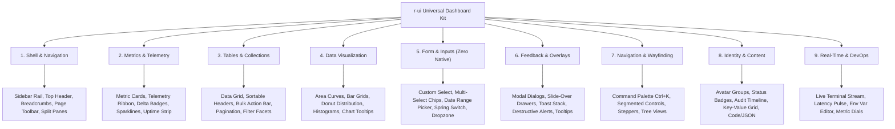

# r-ui Universal Dashboard Kit Architecture Specification (v2.4.0)

> **The Definitive Industry Blueprint for High-Agency, Production-Grade Analytical Consoles & SaaS Dashboards**  
> Built upon the **10 Anti-Slop Visual Laws**, **Dual-Layer Theming**, **Dashboard Hardening**, and **Strict Componentized Form Policy**.

---

## 🏛️ Executive Summary & Design Philosophy

A modern dashboard is not merely an arbitrary cluster of metric cards with generic purple gradients (*AI slop*). World-class dashboards (such as Stripe, Vercel, Supabase, Linear, Cloudflare, and Datadog) prioritize:
1. **High Visual Density & Information Hierarchy**: Data-dense layouts utilizing crisp micro-elevations (1–3px) and 1px hairlines rather than murky black drop-shadows.
2. **Dashboard Hardening (Anti-Card Overuse)**: Unifying related metrics into **Architectural Telemetry Ribbons** with thin vertical hairline dividers instead of boxing every single metric into isolated floating cards.
3. **Zero Raw Native Forms**: 100% of form components (especially Select, Multi-Select, Checkbox, Toggle) utilize custom accessible DOM popovers adhering to theme tokens and WCAG 2.2 AA.
4. **Actionable Workflows**: Data tables featuring instant search, faceted filters, bulk action floating bars, responsive pagination, and slide-over inspector drawers.

---

## 🧩 The 9 Architectural Pillars (45+ Component Taxonomy)



---

## PILLAR 1: SHELL & NAVIGATION ARCHITECTURE

Enterprise-grade application scaffold framework.

### 1.1 Collapsible Sidebar Navigation (`.r-ui-sidebar`)
- **Expanded State (240px–260px)**: Displays system logo, workspace switcher, menu groups (`.r-ui-nav-group-title`), navigation links with leading icons, labels, and trailing badge counters.
- **Mini Rail State (56px–64px)**: Space-saving compact rail for secondary tablet/desktop viewports; displays icons only with floating tooltips on hover.
- **Organization / Workspace Switcher**: Top popover dropdown for instant project/organization switching with active status indicator.
- **User Profile Pill**: Bottom-pinned profile dock displaying user avatar, name, role badge (`Admin`), and popover status triggers.

### 1.2 App Navigation Header (`.r-ui-header`)
- **Breadcrumb Trail**: Dynamic path hierarchy (`Infrastructure / Edge Clusters / US-East-1`) with subtle slash dividers and responsive truncation.
- **Command Palette Trigger Button**: Search button / shortcut indicator (`Ctrl + K` / `⌘ + K`) with custom shortcut keycaps.
- **Environment & Branch Selector**: Active environment pill badge (e.g. `production • main` vs `staging • pr-42`).
- **Action Group**: Notification center trigger with unread alert pulse dot, Help/Docs link, and live Theme/Accent Switcher.

### 1.3 Page Header & Action Hero Bar (`.r-ui-page-header`)
- **Header Metadata**: Page title (h1, semi-bold 1.25rem), status tag (`Healthy`), and concise subtitle description.
- **Action Toolbar**: Date-Range picker popover, filter drawer trigger, export button (`CSV/JSON`), and primary action button (`+ New Deployment`).

### 1.4 Master-Detail Splitter & Right Inspector Drawer
- Splits workspace into primary entity list and quick inspection panel on the right with zero page reload (*zero context loss*).

---

## PILLAR 2: METRICS & TELEMETRY DISPLAYS

Dense KPI visualization free from unnecessary card isolation.

### 2.1 Metric / Stat Card (`.r-ui-stat-card`)
- **Label**: Micro-typography (0.75rem), secondary color with helper tooltip icon.
- **Primary Value**: Bold numeric telemetry (1.5rem–1.75rem) with localized formatting (e.g. `$148,290.00`, `99.99%`, `14.2 ms`).
- **Delta Trend Badge**: Percentage delta indicator (`+14.8% ↑` in emerald green for positive growth, `-3.2% ↓` in crimson red for errors or drops).
- **Comparison Context**: Micro-text comparison subtitle ("vs previous 30 days").
- **Mini Sparkline**: Embedded SVG trend chart at the card base.

### 2.2 Architectural Telemetry Ribbon (`.r-ui-telemetry-ribbon`)
- Single-row horizontal telemetry strip uniting 4–6 metrics without individual card wrappers.
- Separated by crisp 1px vertical hairline dividers (`--r-ui-color-border-standard`).
- Dramatically conserves vertical viewport space (*high-density agency craft*).

### 2.3 Progress & Quota Gauges (`.r-ui-gauge-bar`, `.r-ui-radial-gauge`)
- **Segmented Bar**: Visualizes quota and capacity utilization (e.g. Storage 72/100 GB) with smooth state transitions.
- **Radial Donut Meter**: Displays CPU / RAM utilization percentage with optical status colors.

### 2.4 Uptime & Latency Pulse Strip (`.r-ui-uptime-strip`)
- Sequence of 90 micro-bars representing 90-day historical system availability.
- Emerald green for normal operations, amber for degraded performance, crimson for downtime.
- Equipped with real-time ping indicator featuring an animated pulse dot (`14ms Ping`).

---

## PILLAR 3: DATA TABLES & COLLECTIONS (CORE WORKHORSE)

The command center for data management in production applications.

### 3.1 High-Density Data Grid (`.r-ui-table`)
- **Sortable Header**: Clickable column headers for asc/desc/neutral sorting with subtle directional chevron icons.
- **Row Selection**: Custom accessible checkbox in each row and table header with indeterminate ("Select All") support.
- **Hover & Selected States**: Smooth background transitions on row hover and subtle active outline when selected.
- **Monospace Numerical Alignment**: Numeric columns (prices, latency, percentages) strictly declare right alignment and monospace font (`text-align: right; font-family: var(--r-ui-font-family-mono); font-variant-numeric: tabular-nums;`).
- **Action Menu**: Row kebab dropdown (`...`) exposing Edit, View Logs, Clone, Delete actions.
- **Expandable Rows**: Accordion drawer for nested sub-entities, stack traces, or JSON payloads.

### 3.2 Faceted Filter Bar & Active Filter Chips (`.r-ui-filter-bar`)
- **Search Input**: Real-time filtering input with clear button (`×`) and leading search icon.
- **Facet Filter Popovers**: Category-based filter triggers (Status, Role, Region) opening checkbox popover menus.
- **Active Chips Strip**: Displays applied filters as dismissible mini-chips with single or bulk removal (*Clear all*).
- **Preset Segmented Views**: Fast view tabs: *"All (1,240)"*, *"Active (890)"*, *"Suspended (42)"*, *"Requires Attention (5)"*.

### 3.3 Bulk Action Bar (`.r-ui-bulk-bar`)
- Floating action dock anchored to the bottom viewport, automatically appearing when `> 0` rows are selected.
- Displays selection counter: *"3 entities selected"*.
- Bulk actions: *Export Selected*, *Tag*, *Suspend*, *Delete Selected*, and *Deselect All*.

### 3.4 Table Pagination & Page Size Controller (`.r-ui-pagination`)
- **Counter Info**: *"Showing 1–25 of 1,420 entries"*.
- **Page Size Select**: Custom Select dropdown (`10`, `25`, `50`, `100` per page).
- **Navigation Controls**: First, Previous, Active Page Number, Next, Last, and direct page jump input.

### 3.5 Empty State & Skeleton Shimmer Loaders
- **Empty State**: Minimalist vector icon, clear title (*"No transactions found"*), actionable resolution hint (*"Adjust your active filters or record a new transaction"*), and primary CTA button.
- **Skeleton Shimmer**: Smooth light-wave animated placeholders preventing Cumulative Layout Shift (CLS) during data fetching.

---

## PILLAR 4: DATA VISUALIZATION & ANALYTICS WIDGETS

Integrated SVG charts respecting canvas and accent theme tokens.

### 4.1 Time-Series Area & Line Charts (`.r-ui-chart-area`)
- Smooth cubic Bezier curves with low-opacity gradient fills (maximum 15% opacity).
- Interactive vertical crosshair ruler tracking mouse position.
- Floating tooltip card following cursor, detailing timestamps and series values.

### 4.2 Grouped & Stacked Bar Charts (`.r-ui-chart-bar`)
- Vertical or horizontal bars with subtle rounded caps (2–3px radius).
- Distinct negative value rendering below the baseline axis.

### 4.3 Donut & Radial Distribution Charts (`.r-ui-chart-donut`)
- SVG donut ring with centered aggregate label (*"Total 100%"* or *"4,821 Requests"*).
- Interactive legend chips positioned beside or below chart canvas.

### 4.4 Latency Histogram & Real-Time Sparklines
- P50, P90, P99 latency bucket distribution.
- Micro-sparklines embeddable within table cells.

---

## PILLAR 5: COMPONENTIZED FORM CONTROLS (ZERO NATIVE FORMS)

Per **r-ui Law 9**: All form controls must utilize custom, isolated, and accessible DOM components.

### 5.1 Custom Accessible Select (`.r-ui-custom-select`)
- Trigger button displaying active selection, status indicator, and rotating SVG chevron.
- Floating popover menu matching active canvas theme, micro-elevated, scrollable, with full keyboard navigation and W3C ARIA combobox/listbox attributes.

### 5.2 Multi-Select with Removable Chips (`.r-ui-multi-select`)
- Selected items rendered as compact removable chips (`×`) inside trigger button.
- Popover menu with real-time search, "Select All" toggle, and individual option checkboxes.

### 5.3 Date & Date-Range Picker (`.r-ui-date-picker`)
- Quick preset range buttons: *"Today"*, *"Last 7 Days"*, *"Last 30 Days"*, *"This Month"*, *"Custom"*.
- Dual calendar popover for start and end date selection with highlighted visual range.

### 5.4 Text, Search & Number Inputs (`.r-ui-input`)
- Prefix slots (icons / currency symbols) and suffix slots (clear button, copy action, unit indicators `ms`, `GB`).
- Precision number steppers with increment/decrement buttons.
- Standardized visual validation states: `.is-error`, `.is-warning`, `.is-success` with helper micro-text.

### 5.5 Tactile Spring Switch, Checkbox & Radio Cards
- **Spring Switch**: Tactile toggle slider with physical spring curve.
- **Custom Checkbox**: Accessible checkbox with crisp SVG checkmark and indeterminate state.
- **Radio Cards**: Outlined card options featuring title, description, badge, and integrated radio ring.

### 5.6 Drag-and-Drop File Upload Zone (`.r-ui-dropzone`)
- Dashed border dropzone with upload icon, allowed MIME type descriptions, and size limits.
- Uploaded file list with progress bar, filename, file size, and remove/cancel action.

---

## PILLAR 6: FEEDBACK, OVERLAYS & DRAWERS

Non-intrusive notifications, dialogs, and contextual inspection panels.

### 6.1 Modal Dialogs (`.r-ui-modal`)
- Centered overlay with hardware-accelerated backdrop blur (`backdrop-filter: blur(8px)`).
- Distinct header with title and close button (`×`), scrollable body, and right-aligned footer action bar.

### 6.2 Slide-Over Sheet / Inspector Drawer (`.r-ui-drawer`)
- Right-sliding drawer for deep entity inspection without leaving the primary view.
- Header with entity status, multi-tab details, and sticky footer action buttons.

### 6.3 Slide-in Notification Toast Stack (`.r-ui-toast`)
- Fixed container in bottom-right viewport with spring-animated toast stack.
- Variants: Success (emerald), Error (crimson), Warning (amber), Info (theme accent).
- Equipped with concise message, status icon, action link (*"Undo"*), and auto-dismiss timer bar.

### 6.4 Destructive Confirmation Dialog
- Failsafe modal for irreversible operations (e.g. database drop or terminating production instance).
- Requires explicit entity name typing before enabling the destructive confirmation button.

### 6.5 Tooltips & Context Menus (`.r-ui-tooltip`, `.r-ui-popover`)
- Micro-tooltips with directional pointer arrows, appearing instantly on hover/keyboard focus.
- Context menu popovers for right-click or kebab actions (`...`).

---

## PILLAR 7: NAVIGATION & WAYFINDING

Lightning-fast contextual navigation for power users.

### 7.1 Command Palette (`Ctrl + K` / `⌘ + K`) (`.r-ui-command-palette`)
- Centered global modal with backdrop blur.
- Fuzzy search categorized into: *Navigation Pages*, *Quick Actions*, *Settings*, *Documentation*.
- Full keyboard navigation (`ArrowUp` / `ArrowDown`) and execution via `Enter`.

### 7.2 Segmented Control & Tabs (`.r-ui-segmented`, `.r-ui-tabs`)
- **Segmented Control**: Mode switcher with elevated surface backdrop and spring-physics active capsule slider.
- **Line Tabs**: Clean underline tabs with dynamically sliding active indicator.

### 7.3 Multi-Step Wizard / Stepper (`.r-ui-stepper`)
- Sequential progress bar (*Step 1 of 4*) with completed checkmarks, active step ring, and connecting progress track.

---

## PILLAR 8: IDENTITY, CONTENT & DISPLAY

Technical metadata, user identity, and structured display formatting.

### 8.1 Avatars & Stacked Avatar Groups (`.r-ui-avatar-group`)
- Avatars with user photos or accent fallback initials.
- Online/offline presence dot pinned to avatar corner.
- Stacked avatar groups with negative margin offsets and remainder badge (*"+4"*).

### 8.2 Status Badges with Pulse Animation (`.r-ui-badge`)
- Monospaced semantic badges with hairline borders and soft background tints.
- Equipped with an animated pulsing dot for live status indication.

### 8.3 Activity Timeline & Audit Feed (`.r-ui-timeline`)
- Vertical timeline track with status icon nodes at each event.
- Displays actor avatar, action summary (*"Deploy build #8942 to production"*), commit hash badge, and relative timestamp (*"4 minutes ago"*).

### 8.4 Key-Value / Description List (`.r-ui-kv-list`)
- Clean two-column grid pairing metadata keys with values.
- One-click copy button for IDs, API keys, or public endpoints.

### 8.5 Code Snippet & JSON Inspector (`.r-ui-code-box`)
- Terminal-styled monospace code block with syntax highlighting, line numbers, and copy-to-clipboard button.

---

## PILLAR 9: REAL-TIME & DEVOPS / HIGH-AGENCY CONSOLES

Mission-critical tooling for engineers, infrastructure operators, and system administrators.

### 9.1 Live Streaming Terminal Console (`.r-ui-terminal`)
- Dark-tech console screen with streaming real-time monospaced logs.
- Log level color coding: `INFO` (cyan/emerald), `WARN` (amber), `ERROR` (crimson), `DEBUG` (muted gray).
- Auto-scroll lock toggle, search filter bar, and clear/download log actions.

### 9.2 Key-Value Environment Variable Editor
- Dynamic editor for adding, editing, and deleting configuration variables (`KEY=VALUE`) with secret masking eye toggles.

---

## 📋 Comprehensive Dashboard Kit Implementation Checklist

When asked to construct a Dashboard Kit or admin console, agents must verify inclusion of all 9 pillars:

```text
[ ] PILLAR 1: Sidebar (Collapsible), Header, Breadcrumbs, Page Action Toolbar.
[ ] PILLAR 2: Stat KPI Cards with Delta %, Telemetry Ribbon, Sparklines, Uptime Strip.
[ ] PILLAR 3: High-Density Table, Sortable Header, Row Checkbox, Bulk Action Bar, Pagination, Facet Filters.
[ ] PILLAR 4: Area Chart, Bar Chart, Donut Distribution, Real-time Histogram.
[ ] PILLAR 5: Custom Select, Multi-Select Chips, Date-Range Picker, Spring Switch, Checkbox, Dropzone (Zero Native Forms!).
[ ] PILLAR 6: Modal Dialog, Slide-Over Sheet / Drawer, Toast Stack, Destructive Confirm Dialog, Tooltips.
[ ] PILLAR 7: Command Palette (Ctrl+K), Segmented Control, Line Tabs, Stepper.
[ ] PILLAR 8: Avatar Group, Status Badges with Pulse Dot, Activity Audit Timeline, Key-Value List, Code Box.
[ ] PILLAR 9: Live Terminal Console, Uptime / Latency Ping, Secret Masking Editor.
```
