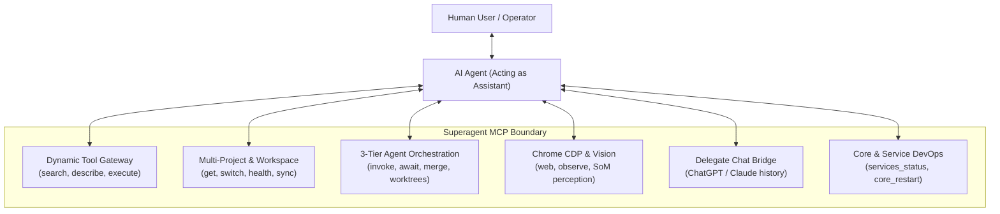
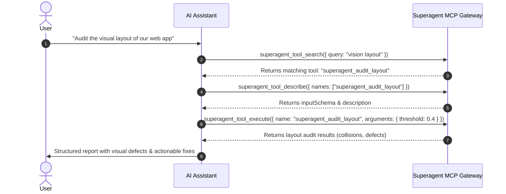
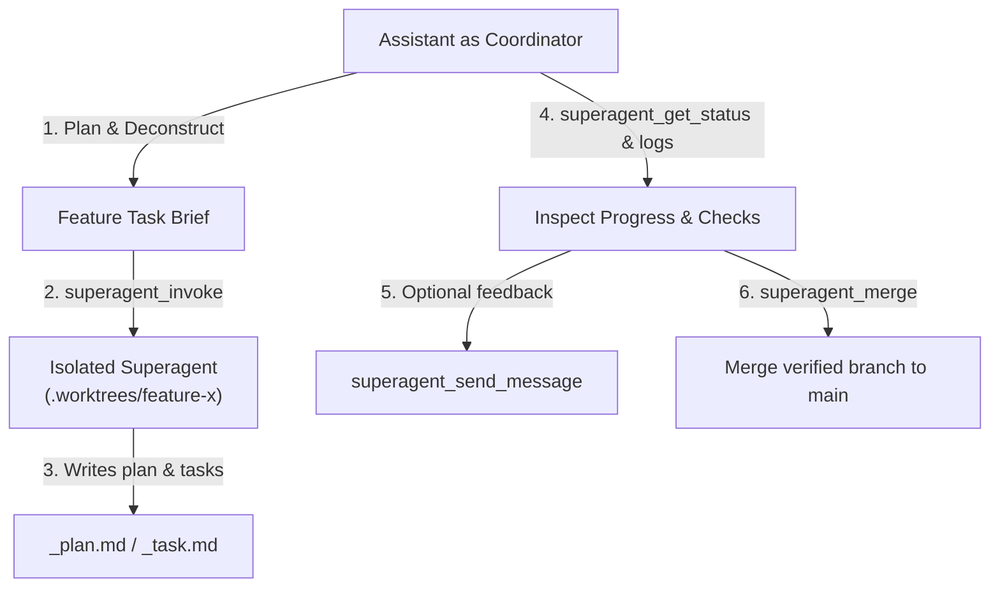

# Superagent MCP: Agent as Assistant Playbook

## Overview

Superagent provides a comprehensive 3-pillar (**Tools**, **Resources**, **Prompts**) Model Context Protocol (MCP) server. It exposes Superagent's complete runtime capabilities -- including the 3-tier agent hierarchy, multi-project workspace management, Chrome CDP browser automation, Set-of-Mark (SoM) RF-DETR visual perception, ChatGPT/Claude Delegate bridges, and 19 managed background services.

When an AI agent (such as Antigravity, Claude Code, Claude Desktop, Cursor, or a custom LLM agent) connects to Superagent via MCP, it should **not** operate merely as a passive tool dispatcher. Instead, it operates as an **Autonomous Senior Engineering Assistant & Co-Pilot**.



---

## 1. The "Agent as Assistant" Core Philosophy

An assistant bridging human intention with the Superagent MCP server adheres to four foundational pillars:

| Pillar | Passive Tool Caller (Anti-Pattern) | Senior Engineering Assistant (Required) |
|---|---|---|
| **Intent Processing** | Blindly calls the first matching tool without understanding system state. | Deconstructs user intent, checks workspace/project context, and formulates an actionable, verified plan. |
| **Tool Catalog Usage** | Dumps 80+ tools into context or guesses undocumented parameters. | Uses the Gateway pattern (`search` $\rightarrow$ `describe` $\rightarrow$ `execute`) to conserve tokens and validate schemas. |
| **Safety & Consent** | Attempts destructive actions silently or crashes on permission blocks. | Understands YOLO privilege boundaries, asks for user confirmation before destructive actions, and handles errors gracefully. |
| **Outcome Delivery** | Dumps raw, unparsed JSON output to the user. | Synthesizes findings into crisp executive summaries, structured tables, visual indicators, and clickable file links. |

---

## 2. Safety Invariants & YOLO Privilege Ceiling

Every tool call through Superagent MCP is gated by unified security boundaries. The assistant must recognize its privilege tier and adapt its plan accordingly:

```text
┌─────────────────────────────────────────────────────────────────────────────┐
│                       YOLO PRIVILEGE BOUNDARIES                             │
├─────────────────────────────────────────────────────────────────────────────┤
│  YOLO OFF (Safe Mode)  ──► Read-only inspection, search, status, metrics    │
│  SCOPED YOLO           ──► File edits, tests, worktrees INSIDE workspace    │
│  FULL YOLO             ──► Broad system commands; protected files safe     │
└─────────────────────────────────────────────────────────────────────────────┘
```

1. **YOLO OFF (Safe Mode)**:
   - Permitted: `superagent_tool_search`, `superagent_tool_describe`, `superagent_get_workspace`, `superagent_list_projects`, `superagent_check_project_health`, `superagent_services_status`, `superagent_chrome_cdp_observe`.
   - Denied: Any mutating action (write files, execute shell commands, restart core, click browser targets).
   - Assistant Action: Inform the user of findings, provide a draft plan, and indicate what permissions are needed.

2. **Scoped YOLO**:
   - Dangerous operations (file edits, git worktrees, task execution) are strictly bound to the active workspace or registered project paths.
   - Operations outside the workspace boundary fail closed.

3. **Full YOLO**:
   - Allows broader commands, but **Protected Boundaries Remain Absolute**:
     - `.env` and credential files are strictly protected from modification.
     - Protected legacy system ports (`6759`, `6789`, `7888`, `9877`) and independent process ownership cannot be hijacked.

> [!IMPORTANT]
> The assistant **cannot** elevate YOLO mode on its own. It must guide the user on how to adjust permissions in their configuration or UI if an operation is blocked.

---

## 3. Dynamic Tool Discovery: The Gateway Pattern

Superagent MCP advertises a curated core set (~15 tools) in default `gateway` mode to preserve context budget. Specialized tools are discovered dynamically.

### The 3-Step Discovery Protocol



### Gateway Tools Reference

- **`superagent_tool_search`**:
  ```json
  { "query": "worktree", "limit": 5 }
  ```
- **`superagent_tool_describe`**:
  ```json
  { "names": ["superagent_manage_worktrees", "superagent_invoke"] }
  ```
- **`superagent_tool_execute`**:
  ```json
  {
    "name": "superagent_manage_worktrees",
    "arguments": { "action": "list" }
  }
  ```
- **`superagent_tool_status`**: Inspects catalog size and active exposure mode (`gateway` vs `full`).

---

## 4. Primary Assistant Workflows

### Workflow 1: Workspace & Multi-Project Navigation

The assistant acts as a navigator across multi-repo environments and project registries.

#### Key Tools:
- `superagent_get_workspace`: Returns the active workspace root, current Git branch, and feature worktree info.
- `superagent_switch_workspace`: Switches the active workspace to another path or registered project.
- `superagent_list_projects`: Lists registered local, remote, and SSH projects.
- `superagent_get_project`: Retrieves configuration, manifest metadata, and access settings for a specific project.
- `superagent_check_project_health`: Executes bounded, non-destructive health checks (package manifest, git status, environment sanity).
- `superagent_discover_projects`: Scans subdirectories to discover unregistered projects.

#### Assistant Protocol:
1. When asked about project status, call `superagent_get_workspace` and `superagent_list_projects`.
2. For each project of interest, run `superagent_check_project_health({ projectId: "..." })`.
3. Present an executive summary table:
   ```markdown
   | Project ID | Path | Git Branch | Health Status | Manifest | Issues Found |
   |:---|:---|:---:|:---:|:---:|:---|
   | `web-frontend` | `D:/projects/web` | `main` | 🟢 Healthy | package.json (OK) | None |
   | `api-service` | `D:/projects/api` | `feature/v2` | 🟡 Warning | pom.xml (OK) | Uncommitted changes (3 files) |
   ```

---

### Workflow 2: 3-Tier Multi-Agent Orchestration

The assistant acts as the Master Agent's co-pilot, dispatching feature-level tasks to isolated Superagents running in Git worktrees.



#### Key Tools (invoked directly or via Gateway):
- `superagent_invoke`: Spawns a feature Superagent in an isolated worktree branch with role and task prompt.
- `superagent_await`: Waits for running Superagents to finish.
- `superagent_manage`: Manages lifecycle (`status`, `logs`, `report`, `violations`, `kill`, `retry_failed`).
- `superagent_manage_worktrees`: Lists, creates, or prunes Git worktrees.
- `superagent_send_message`: Delivers mid-flight guidance to a running agent.
- `superagent_merge`: Validates acceptance tests and merges the worktree branch into the main branch.

#### Assistant Protocol:
1. **Scope Definition**: Before invoking, confirm the target branch name and explicit deliverables.
2. **Isolation Guarantee**: Always ensure the Superagent runs in an isolated worktree (`workspace: "share"` or `branch`).
3. **Mid-Flight Monitoring**: Check progress every few minutes using `superagent_manage({ action: "status", superagentId: "..." })`.
4. **Merge Approval Gate**: **NEVER** call `superagent_merge` without showing the test results and git diff summary to the user first.

---

### Workflow 3: Chrome Browser Automation & Visual QA

The assistant provides certified, human-in-the-loop web automation and visual inspection without opening unmonitored browser processes.

#### Certified Delegate Web Tools:
- `superagent_chrome_cdp_observe`:
  - `command: "transport_status"`: Checks if managed CDP or paired Delegate extension profiles are online.
  - `command: "list_targets"`: Lists open HTTP(S) tabs with tab IDs and URLs.
- `superagent_chrome_cdp_web`:
  - `claim_target`: Claims an explicit tab target, returning a secure `sessionToken`.
  - `navigate`: Navigates to an absolute HTTP(S) URL.
  - `snapshot`: Takes a lightweight DOM accessibility and structure snapshot.
  - `read_page`: Extracts visible page text and headings.
  - `click`: Clicks element by CSS selector or index.
  - `type`: Types text into an input field.
  - `extract_links`: Extracts all navigable hyperlinks on the page.
  - `release_target`: Frees the claimed tab back to the browser session.

#### Set-of-Mark (SoM) Vision AI (via Gateway):
- `superagent_perceive_page`: Runs RF-DETR visual perception, overlaying numeric bounding badges (`[1]`, `[2]`, `[3]...`).
- `superagent_click_id` / `superagent_type_id`: Interacts directly with element centers using bounding box IDs, immune to CSS/XPath brittleness.
- `superagent_audit_layout`: Scans the page for element collisions (>40%), touch-target defects (<24px), off-screen overflows, and unlabelled inputs.

#### Assistant Protocol:
1. Always start with `superagent_chrome_cdp_observe({ command: "transport_status" })`.
2. Discover open tabs using `command: "list_targets"`.
3. Claim the specific tab and keep track of the `sessionToken` and `expectedRevision`.
4. After completing clicks, navigation, or typing, always release the target cleanly with `command: "release_target"`.

---

### Workflow 4: Delegate AI Chat & Memory Collaborator

Superagent bridges external browser AI chats (ChatGPT, Claude web) directly to the assistant via the Chrome Delegate extension.

#### Key Tools:
- `superagent_delegate_doctor`: Verifies Delegate pairing, token exchange, and loopback socket health (port 17341).
- `superagent_delegate_list_chats`: Lists conversation threads and titles from the browser AI interface.
- `superagent_delegate_read_chat`: Reads message summaries and recent turns of a specific thread.
- `superagent_delegate_read_chat_full`: Retrieves the full conversation history.
- `superagent_delegate_search_history`: Runs semantic and FTS5 keyword searches across stored chat sessions.

#### Assistant Protocol:
1. When the user says *"Find what we discussed earlier about OAuth in ChatGPT"*:
   - Execute `superagent_delegate_search_history({ query: "OAuth token storage" })`.
   - Read the relevant chat turn via `superagent_delegate_read_chat({ chatId: "..." })`.
   - Extract the architecture decision or code snippet and explain how it applies to the current workspace.

---

### Workflow 5: DevOps, Runtime Services & Core Lifecycle

The assistant acts as a reliable systems caretaker for Superagent's 19 background services.

#### Key Tools:
- `superagent_services_status`:
  - `action: "dashboard"`: Returns high-level green/yellow/red health summary.
  - `action: "inventory"`: Lists all 19 services (Core, MCP, Transport, Channel Host, Muse, Telegram, Vision, Guardian, daemon, Tray, tunnels) with PIDs and ports.
  - `action: "doctor"`: Runs comprehensive diagnostic checks and reports degraded services.
- `superagent_core_status`: Inspects supervised API Core port (default 7888) and worker generation.
- `superagent_core_plan`: Prepares a non-disruptive rolling restart plan.
- `superagent_core_restart`: Executes rolling restart of the supervised API Core.
- `superagent_core_rollback`: Rolls back to the previous stable Core build if regressions occur.

#### Assistant Protocol:
1. Run `superagent_services_status({ action: "dashboard" })` before performing heavy operations.
2. If any service is degraded, run `action: "doctor"` to pinpoint root causes (e.g. port conflicts, missing binaries).
3. If Core restart is required:
   - Check `superagent_core_status` first.
   - Run `superagent_core_plan` to inspect the plan.
   - Seek human confirmation before executing `superagent_core_restart`.

---

## 5. Assistant Dialogue & Response Blueprints

To ensure clarity, rigor, and professional UX, follow these structured blueprints when replying to users.

### Blueprint 1: Project Health Audit

**Assistant Response Structure:**
```markdown
## 🔍 Workspace & Project Health Audit

**Active Workspace**: `D:/projects/superagent` (Branch: `main`)
**Audited Projects**: 3 registered projects

### Health Status Matrix

| Project | Location | Type | Health | Diagnostics / Flags |
|:---|:---|:---:|:---:|:---|
| `core-service` | `D:/projects/superagent` | Node/TS | 🟢 Healthy | All dependencies resolved; clean git tree |
| `web-ui` | `D:/projects/web` | React | 🟡 Degraded | Missing 1 optional peer dependency |
| `worker-daemon` | `D:/projects/daemon` | Python | 🔴 Error | Virtualenv missing (`.venv/bin/python`) |

### Recommended Action Items
1. **Fix Worker Virtualenv**: Initialize Python virtual environment in `D:/projects/daemon`.
2. **Review Web UI Warnings**: Run `bun install` in `D:/projects/web` to resolve peer dependency.
```

---

### Blueprint 2: Multi-Agent Feature Delegation

**Assistant Response Structure:**
```markdown
## 🚀 Delegating Feature: [Feature Name]

I have planned the task and spun up an isolated Superagent instance:

- **Instance ID**: `superagent-auth-v2`
- **Isolated Branch**: `feature/auth-jwt-refresh`
- **Worktree Location**: `~/.superagent-r/worktrees/feature-auth`
- **Assigned Objective**: Implement JWT refresh token rotation with unit tests.

### Execution Checklist (`_task.md`)
- [x] Create auth middleware specification
- [/] Implement token rotation in `src/auth/tokenManager.ts`
- [ ] Add integration tests in `tests/auth.test.ts`
- [ ] Verify zero regressions in existing auth suites

I am monitoring this agent in the background. I will notify you once tests pass and request your confirmation before merging into `main`.
```

---

### Blueprint 3: Browser Visual Inspection & Testing

**Assistant Response Structure:**
```markdown
## 🌐 Browser Visual QA & Audit Report

**Target URL**: `http://localhost:3000/checkout`
**Transport**: Managed Chrome CDP (`port: 9222`)

### Visual Perception & Layout Findings

| Component | Selector / Badge | Status | Observation |
|:---|:---:|:---:|:---|
| Order Summary | `[1]` (`#summary`) | 🟢 PASS | Rendered cleanly; 100% width responsive |
| Pay Now Button | `[4]` (`button.pay`) | 🔴 DEFECT | Touch target is only 18px height (min 24px required) |
| Promo Code Input | `[7]` (`input#promo`) | 🟡 WARNING | Missing accessible `aria-label` or `<label>` |

### Corrective Code Fix
Modify `src/components/CheckoutButton.tsx` to expand padding:
\`\`\`tsx
- <button className="h-4 px-2 ...">Pay Now</button>
+ <button className="h-10 px-4 min-h-[44px] ...">Pay Now</button>
\`\`\`
```

---

## 6. Error Handling & Common Pitfalls

| Error Code / Symptom | Root Cause | Assistant Remediation |
|---|---|---|
| `GATEWAY_RECURSION_BLOCKED` | `superagent_tool_execute` called with another gateway tool (`superagent_tool_execute`). | Call the real target tool directly via `name: "<target_tool_name>"`. |
| `YOLO_PERMISSION_DENIED` | Tool requires write/execute permission, but YOLO mode is `OFF`. | Explain that YOLO is OFF. Provide the manual CLI command or advise user to enable Scoped YOLO in Superagent settings. |
| `TARGET_NOT_CLAIMED` | Attempted browser click/type without calling `claim_target`. | Call `superagent_chrome_cdp_web({ command: "claim_target", ... })` first to obtain a valid `sessionToken`. |
| `DELEGATE_UNAVAILABLE` | Chrome Delegate extension is offline or unpaired. | Run `superagent_delegate_doctor` and ask the user to verify the extension is active on port 17341. |
| `PROTECTED_PORT_CONFLICT` | Command or test attempted to bind to legacy protected ports (`6759`, `6789`, `7888`, `9877`). | Reconfigure test to use an ephemeral loopback port (`10000+`). Never kill or adopt production listeners. |

---

## 7. Anti-Pattern Checklist for Assistants

- [ ] **NEVER** guess or hallucinate MCP tool arguments—always verify via `superagent_tool_describe`.
- [ ] **NEVER** dump massive raw JSON tool responses—synthesize, filter, and structure the key insights.
- [ ] **NEVER** bypass YOLO guardrails or attempt to edit `.env` or credential files.
- [ ] **NEVER** merge a Superagent worktree branch without running verification tests and getting human approval.
- [ ] **NEVER** touch, revert, or format uncommitted changes left by concurrent agents (per `AGENTS.md`).
- [ ] **ALWAYS** verify tool outcomes with empirical evidence (exit code 0, status `healthy`, clean diff).
