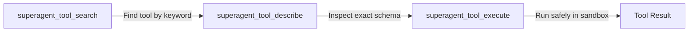

# Using Superagent MCP: Operational Guide & Workflows

## Overview

Superagent provides a complete 3-pillar (**Tools**, **Resources**, **Prompts**) Model Context Protocol (MCP) server. It exposes the entire Superagent multi-tier architecture, workspace filesystem, browser automation engines, remote AI delegate bridges, and background service lifecycle to external AI assistants (such as Antigravity, Claude Code, Claude Desktop, Cursor, T-Line, or custom scripts).

This guide walks through connecting to the server, configuring clients, and executing the 5 primary operational workflows with actionable examples.

---

## 1. Connecting Clients to Superagent MCP

### A. Connection Architecture & Transports

Superagent MCP supports two primary transports:
1. **Stdio Transport (Local CLI / Subprocess)**: Used when an AI assistant (like Antigravity or Claude Desktop) spawns Superagent directly via standard I/O.
2. **Streamable HTTP / WebSocket Tunnel**: Used for remote or network mesh access via `superagent /muse tunnel start --mcp` or loopback listeners (`http://127.0.0.1:6759` or configured port).

### B. Client Configuration Examples

#### 1. Antigravity Configuration (`mcp_config.json` or MCP settings)
```json
{
  "mcpServers": {
    "superagent": {
      "command": "bun",
      "args": ["run", "src/cli.tsx", "mcp"],
      "cwd": "D:/backup from pc asus/Documents Development/superagent",
      "env": {
        "SUPERAGENT_MCP_TOOL_EXPOSURE": "gateway"
      }
    }
  }
}
```

#### 2. Claude Desktop (`claude_desktop_config.json`)
```json
{
  "mcpServers": {
    "superagent": {
      "command": "bun",
      "args": ["run", "D:/backup from pc asus/Documents Development/superagent/dist/cli.js", "mcp"],
      "env": {
        "SUPERAGENT_MCP_TOOL_EXPOSURE": "gateway"
      }
    }
  }
}
```

### C. Tool Exposure Modes: Gateway vs Full

Superagent supports two operational modes via `SUPERAGENT_MCP_TOOL_EXPOSURE` or `~/.superagent-r/mcp-tool-exposure.json`:

| Mode | Tools Advertised | Best Used For |
|---|---|---|
| **`gateway` (Default & Recommended)** | ~20 curated tools (discovery, workspace, status, delegate readers) | Preserves context budget; tools are discovered and executed dynamically on demand. |
| **`full`** | All 80+ tools across all domains | High-context agents needing immediate visibility into every specialized schema. |

---

## 2. Security Boundaries & YOLO Privilege Ceiling

Every tool invocation through the Superagent MCP server is enforced by strict security gates:

1. **YOLO OFF (Safe Mode)**:
   - All tools classified as `dangerous` (e.g. `write_file`, `replace_file_content`, `exec_command`, `core_restart`) are rejected with an authorization error.
   - Read-only inspection tools (`read_file`, `core_status`, `list_projects`, `tool_search`) remain fully available.
2. **Scoped YOLO**:
   - Dangerous file and command operations are permitted **only** within the active workspace root or explicitly registered project paths.
   - Out-of-boundary access is denied.
3. **Full YOLO**:
   - Broad filesystem operations are permitted, but **Protected File Boundaries** remain strictly enforced:
     - Sensitive credentials (`.env`, private keys, OAuth stores) cannot be modified.
     - Protected legacy system ports (`6759`, `6789`, `7888`, `9877`) and independent process ownership cannot be hijacked.

> [!IMPORTANT]
> The YOLO privilege ceiling is immutable from agent prompts. Only the authorized human operator can alter YOLO mode via configuration or UI toggles.

---

## 3. Workflow 1: Dynamic Tool Discovery (Gateway Pattern)

In `gateway` mode, clients do not need 80+ tools in their context window. Instead, follow the 3-step **Search $\rightarrow$ Describe $\rightarrow$ Execute** cycle:



### Step 1: Search the Catalog
Search for relevant tools using keywords, intent, or tool name substrings:
```json
// Call superagent_tool_search
{
  "query": "chrome cdp",
  "limit": 5
}
```
*Response returns matching tool names, summaries, and classifications (safe/dangerous).*

### Step 2: Describe the Tool Schema
Inspect parameter requirements before invocation:
```json
// Call superagent_tool_describe
{
  "names": ["superagent_chrome_cdp"]
}
```
*Response returns the complete JSON schema including required properties and enum options.*

### Step 3: Execute the Tool Safely
Invoke the tool through the gateway:
```json
// Call superagent_tool_execute
{
  "name": "superagent_chrome_cdp",
  "arguments": {
    "command": "screenshot"
  }
}
```

---

## 4. Workflow 2: Workspace & Multi-Project Management

Manage repository roots, auto-discover subprojects, and enforce project isolation.

### Step 1: Check Active Workspace
```json
// Call superagent_get_workspace
{}
```
*Returns the current working directory, git branch, and worktree status.*

### Step 2: Switch Active Workspace
```json
// Call superagent_switch_workspace
{
  "targetPath": "D:/projects/e-commerce-backend"
}
```

### Step 3: Discover and Register Repositories
Scan a directory tree for git/Node.js projects and import them into Superagent's registry:
```json
// Call superagent_discover_projects
{
  "rootPath": "D:/projects",
  "maxDepth": 2
}
```
Then import chosen projects:
```json
// Call superagent_import_discovered_project
{
  "projectPath": "D:/projects/e-commerce-backend",
  "name": "backend-api"
}
```

### Step 4: Verify Project Health
Ensure project root exists, git repository is clean, and connectivity is verified:
```json
// Call superagent_check_project_health
{
  "projectId": "backend-api"
}
```

---

## 5. Workflow 3: Browser Automation & Vision AI (CDP + Set-of-Mark)

Superagent features native Chrome DevTools Protocol (CDP) control paired with Set-of-Mark (SoM) RF-DETR visual perception.

### Step 1: Launch or Connect Chrome
```json
// Call superagent_launch_chrome
{
  "profile": "Default",
  "headless": false
}
```
Or check existing running Chrome windows:
```json
// Call superagent_list_running_chrome
{}
```

### Step 2: Standard CDP Automation
Perform browser actions via `superagent_chrome_cdp`:
* **Navigate to URL**:
  ```json
  { "command": "navigate", "url": "https://example.com" }
  ```
* **Take Screenshot**:
  ```json
  { "command": "screenshot" }
  ```
* **Device Emulation**:
  ```json
  { "command": "emulate_device", "preset": "mobile" }
  ```
* **Bypass Screen Share Dialogs**:
  ```json
  { "command": "mock_display_media" }
  ```

### Step 3: Visual Interaction via Set-of-Mark (SoM) Perception
When CSS selectors or DOM nodes are hidden by canvas, shadow-DOM, or complex iframes:
1. **Perceive the page**:
   ```json
   // Call superagent_chrome_vision
   {
     "action": "perceive_page"
   }
   ```
   *Returns an annotated screenshot where interactive elements are marked with numeric badge IDs: `[1]`, `[2]`, `[3]`.*
2. **Interact directly via ID**:
   ```json
   // Click badge [2]
   {
     "action": "click_id",
     "id": 2
   }
   ```
3. **Type into an input field**:
   ```json
   // Type into badge [5]
   {
     "action": "type_id",
     "id": 5,
     "text": "Antigravity Superagent"
   }
   ```
4. **Audit visual layout**:
   ```json
   {
     "action": "audit_layout"
   }
   ```
   *Detects element collisions (>40%), touch target size defects (<24px), and off-screen overflows.*

---

## 6. Workflow 4: Delegate Chrome Bridge (ChatGPT / Claude Remote Automation)

Superagent includes a browser bridge connecting directly to web-hosted ChatGPT and Claude sessions via the Superagent Chrome Extension.

### Step 1: Diagnose Bridge Connectivity
```json
// Call superagent_delegate_doctor
{}
```
*Verifies WebSocket connection to browser extension, available profile sessions, and active tabs.*

### Step 2: List Active Chats
```json
// Call superagent_delegate_list_chats
{
  "platform": "chatgpt"
}
```

### Step 3: Read Recent Chat Transcript
```json
// Call superagent_delegate_read_chat
{
  "chatId": "session-uuid-1234"
}
```

### Step 4: Send Message & Await Completion
Send a prompt to the web assistant and wait for complete generation:
```json
// Call superagent_delegate_send_message
{
  "chatId": "session-uuid-1234",
  "message": "Review the latest changes in the authentication module."
}
```
Then await completion:
```json
// Call superagent_delegate_run_until_done
{
  "chatId": "session-uuid-1234",
  "timeoutMs": 60000
}
```

### Step 5: Full-Text Search in Past Conversations
Search across SQLite FTS5 indexed transcripts:
```json
// Call superagent_delegate_search_index
{
  "query": "jwt refresh token fix",
  "limit": 5
}
```

---

## 7. Workflow 5: Core Lifecycle & Managed Background Services

Under the single-runtime deployment contract (R0-R7), Core runtime mutations must follow a two-phase commit protocol to avoid dangling sessions or orphaned process trees.

### Step 1: Inspect Core Health
```json
// Call superagent_core_status
{}
```
*Returns generation ID, active PID, uptime, connected clients, and port listener.*

### Step 2: Plan Core Restart (Preflight Phase)
Generate a stable operation ID and verify build digests:
```json
// Call superagent_core_plan
{}
```
*Returns `operationId` (e.g. `op_abc123`) and `expectedBuildDigest`.*

### Step 3: Execute Verified Restart
```json
// Call superagent_core_restart
{
  "confirm": true,
  "operationId": "op_abc123",
  "expectedBuildDigest": "sha256-digest-value"
}
```

### Step 4: Manage Background Services
Inspect and maintain the 19 supervised Superagent services:
* **List inventory**:
  ```json
  // Call superagent_manage_services
  { "action": "inventory" }
  ```
* **Check system doctor**:
  ```json
  { "action": "doctor" }
  ```
* **Restart specific service**:
  ```json
  { "action": "restart", "serviceName": "vision", "confirm": true }
  ```

---

## 8. Error Handling & Recovery Matrix

| Error Scenario | Root Cause | Safe Recovery Action |
|---|---|---|
| `YOLO_MODE_VIOLATION` | Attempted dangerous tool call while YOLO is OFF or target is outside scope | Check `getYoloModeState()`. Ask operator for approval; do not attempt bypasses. |
| `TARGET_NOT_FOUND` | Window HWND or target PID terminated or invalid | Re-enumerate windows with `superagent_desktop_ui` / `list_running_chrome`. |
| `TOOL_NOT_DESCRIBED` | Direct invocation before calling `describe_tool` | Call `superagent_tool_describe({ names: [toolName] })` first before calling `superagent_tool_execute`. |
| `BRIDGE_UNAVAILABLE` | Chrome Extension not connected or port 9223 unreachable | Run `superagent_delegate_doctor` to check extension status. |
| `OPERATION_ID_EXPIRED` | Core mutation plan timed out | Run `superagent_core_plan` again to get a fresh `operationId`. |

---

## 9. Best Practices Checklist

- [ ] **Always use Gateway Search First**: In dynamic environments, run `superagent_tool_search` rather than guessing parameter names.
- [ ] **Respect Protected Boundaries**: Never attempt to overwrite `.env`, credentials, or model config JSONs via MCP tools.
- [ ] **Use Set-of-Mark for Canvas/Dynamic UIs**: When DOM selectors fail, use `perceive_page` and `click_id` / `type_id`.
- [ ] **Two-Phase Core Mutations**: Always execute `core_plan` before `core_restart`.
- [ ] **Keep Transports Separated**: Never mix WS bridge tunnel traffic with Core HTTP listeners.
